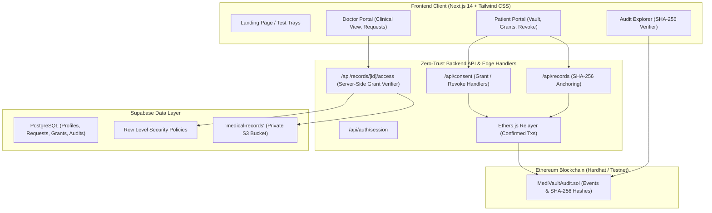

# MediVault — Patient-Controlled Medical Records

[](https://nextjs.org/)
[](https://www.typescriptlang.org/)
[](https://tailwindcss.com/)
[](https://hardhat.org/)
[](https://soliditylang.org/)
[](https://supabase.com/)

> **A full-stack, zero-trust electronic health records (EHR) platform where patients maintain cryptographic sovereignty over their medical data.**
> Physicians obtain only granular, time-limited consent grants. Expired and revoked requests are strictly rejected at the server and storage levels with HTTP 403 Forbidden. Immutable consent proofs and document SHA-256 digests are anchored into an Ethereum Solidity smart contract—**zero personal health information (PHI/PII) ever touches the blockchain.**

---

## Table of Contents
1. [Core Features & Architecture](#core-features--architecture)
2. [Security Model: Zero-Trust EHR & Privacy Guarantees](#security-model-zero-trust-ehr--privacy-guarantees)
3. [Implemented Features vs. Sandbox Mode](#implemented-features-vs-sandbox-mode)
4. [Project Structure](#project-structure)
5. [Quickstart Setup](#quickstart-setup)
6. [Testing the Security Gates](#testing-the-security-gates)
7. [Smart Contract & Hardhat Toolchain](#smart-contract--hardhat-toolchain)
8. [Supabase Setup & Migrations](#supabase-setup--migrations)
9. [Interactive Demo Walkthrough](#interactive-demo-walkthrough)

---

## 1. Core Features & Architecture



### Key Pillars:
- **Patient Sovereignty**: Patients manage all diagnostic records, approve or reject clinician requests, configure explicit expiration durations (1 hour, 6 hours, 24 hours, 7 days), and trigger immediate revocation at any time.
- **Server-Side Zero-Trust Gate (`/api/records/[id]/access`)**: Doctors are never granted direct access to files. Every file request evaluates active grants in real time. **Expired and revoked grants return HTTP 403 Forbidden with audit logging**, preventing bypass even if URLs or storage paths are known.
- **Solidity Audit Contract (`contracts/MediVaultAudit.sol`)**: Records anonymized `keccak256` hashes of consent grants, revocations, and document SHA-256 checksums. **Confirmed transaction verification** guarantees that transactions are never marked successful unless verified (`receipt.status === 1`).
- **Cryptographic Document Integrity Verifier**: Allows any auditor or patient to verify whether a clinical document or lab report has been tampered with. If even a single character is modified, the SHA-256 hash fails verification.

---

## 2. Security Model: Zero-Trust EHR & Privacy Guarantees

| Concern | Traditional EHR Flaw | MediVault Zero-Trust Solution |
| :--- | :--- | :--- |
| **Blockchain Privacy** | Storing medical records or PII on-chain violates HIPAA and GDPR permanently. | **Zero PHI On-Chain**: Only cryptographic digests (SHA-256 / Keccak-256) of events and files touch the blockchain. |
| **Doctor Access Rights** | Broad, indefinite hospital access; access often persists post-consultation. | **Time-Limited Grants**: Access automatically lapses after the granted window (e.g., 24h). |
| **Revocation Velocity** | Bureaucratic revoking process taking days or weeks. | **1-Click Immediate Revocation**: Patient clicks Revoke, which broadcasts to the ledger and immediately cuts backend file access. |
| **Storage Security** | Direct public links or long-lived static URLs. | **Private Storage + Short-Lived Signed URLs**: Supabase bucket is private (`public: false`). Downloads are only accessible via signed URLs generated by the server after active grant validation. |

---

## 3. Implemented Features vs. Sandbox Mode

| Layer / Feature | Implemented Architecture | Sandbox / Local Demo Mode Behavior |
| :--- | :--- | :--- |
| **Next.js Full-Stack App** | Production App Router (`/`, `/patient`, `/doctor`, `/audit`, `/api/*`). | Fully functional out of the box with zero setup friction. |
| **Smart Contract** | `contracts/MediVaultAudit.sol` compiled with Hardhat (EVM paris). | 10 passing unit tests. Can connect to local Hardhat node (`http://127.0.0.1:8545`) or Sepolia testnet. |
| **Server-Side Access Control** | `/api/records/[id]/access` verifies patient ownership or active unexpired unrevoked doctor grant. | Standalone test suite (`npm run test:api`) passes 6/6 tests. |
| **Supabase Database & Storage** | Complete migration script in `supabase/migrations/001_initial_schema.sql` with tables, RLS policies, indexes, and bucket config. | In local demo mode, a persistent reactive `DemoStore` simulates the database with localStorage fallback and rich synthetic records. |
| **Synthetic Healthcare Data** | Strictly synthetic demo patient & doctor records. | Realistic clinical profiles (Sarah Chen, Dr. Aris Thorne, Dr. Maya Patel, Dr. Julian Vance) with pre-calculated SHA-256 hashes. |

---

## 4. Project Structure

```
online hachthon/
├── contracts/
│   └── MediVaultAudit.sol            # Solidity audit contract for consent & document integrity
├── test/
│   └── MediVaultAudit.test.cjs       # 10 comprehensive Hardhat unit tests
├── scripts/
│   ├── deploy.cjs                    # Contract deployment script
│   └── test-access-control.mjs       # Backend authorization test suite (6/6 passing)
├── supabase/
│   └── migrations/
│       └── 001_initial_schema.sql    # PostgreSQL schema, RLS policies, and storage bucket setup
├── src/
│   ├── app/
│   │   ├── page.tsx                  # Landing page with interactive test trays
│   │   ├── layout.tsx                # App layout with Navbar & Footer
│   │   ├── globals.css               # Healthcare styling & animations
│   │   ├── patient/page.tsx          # Patient Sovereign EHR Vault
│   │   ├── doctor/page.tsx           # Doctor Clinical Console
│   │   ├── audit/page.tsx            # Blockchain Audit Explorer & SHA-256 Verifier
│   │   └── api/
│   │       ├── auth/session/         # Role-aware session endpoint
│   │       ├── records/              # Record upload & SHA-256 anchoring
│   │       ├── records/[id]/access/  # Zero-trust server-side authorization gateway
│   │       ├── access-requests/      # Physician request dispatch
│   │       ├── consent/              # Consent grant & immediate revocation
│   │       └── audit/                # Audit ledger indexing & integrity verifier
│   ├── components/
│   │   ├── Navbar.tsx                # Header with quick persona switcher & chain indicator
│   │   └── Footer.tsx                # Architecture & security pillars footer
│   ├── lib/
│   │   ├── blockchain/
│   │   │   └── relayer.ts            # Ethers.js relayer with confirmed transaction logic
│   │   ├── store/
│   │   │   └── demo-store.ts         # Reactive sandbox state engine & client SHA-256 hasher
│   │   ├── supabase/
│   │   │   ├── client.ts             # Supabase browser client
│   │   │   └── server.ts             # Supabase service-role server client
│   │   └── mock-data.ts              # Synthetic clinical datasets & pre-calculated hashes
│   └── types/
│       └── index.ts                  # TypeScript interface definitions
├── .env.example                      # Configuration template
├── hardhat.config.cjs                # Hardhat EVM toolchain configuration
├── package.json                      # Scripts and dependencies
└── tsconfig.json                     # TypeScript compiler configuration
```

---

## 5. Quickstart Setup

### Prerequisites
- Node.js `v18+` or `v20+` (tested and working on `v26.5.1`)
- npm `v9+` or `v12+`

### Installation
```bash
# Clone or navigate to the repository
cd "online hachthon"

# Install all dependencies (Next.js, Tailwind, Supabase SDK, Hardhat, Ethers)
npm install
```

### Environment Configuration
Copy the template configuration:
```bash
cp .env.example .env.local
```

### Run Development Server
```bash
npm run dev
```
Open **[http://localhost:3000](http://localhost:3000)** in your browser.

---

## 6. Testing the Security Gates

MediVault includes two automated test suites verifying both on-chain and off-chain security:

```bash
# Run both test suites in sequence:
npm test
```

### 1. Hardhat Smart Contract Unit Tests
```bash
npm run test:contract
```
Verifies:
- Deployer ownership and initialization
- `recordConsentGrant` with future expiration & event emission
- Unauthorized caller rejection
- Past expiration timestamp rejection
- Time-travel simulation verifying expired grant detection
- `recordConsentRevocation` immediate invalidation
- Rejection of already-revoked grants
- Document SHA-256 integrity anchoring and duplicate rejection

### 2. Backend Access-Control & Security Tests
```bash
npm run test:api
```
Verifies:
- **Test 1**: Patient accessing own record returns `HTTP 200` (`PATIENT_OWNER`).
- **Test 2**: Doctor with ACTIVE grant returns `HTTP 200` (`ACTIVE_GRANT`).
- **Test 3**: Doctor with EXPIRED grant is strictly DENIED with `HTTP 403` (`ACCESS_DENIED_EXPIRED`).
- **Test 4**: Doctor with REVOKED grant is strictly DENIED with `HTTP 403` (`ACCESS_DENIED_REVOKED`).
- **Test 5**: Doctor with NO grant is strictly DENIED with `HTTP 403` (`ACCESS_DENIED_NO_GRANT`).
- **Test 6**: Document tampering detection via cryptographic SHA-256 mismatch.

---

## 7. Smart Contract & Hardhat Toolchain

### Compile Solidity Contract
```bash
npm run compile
```

### Deploy to Local Hardhat Node
1. In a separate terminal, start a local Ethereum node:
   ```bash
   npx hardhat node
   ```
2. Deploy the contract:
   ```bash
   node scripts/deploy.cjs --network localhost
   ```
This updates `src/lib/blockchain/deployment.json` with the deployed address.

---

## 8. Supabase Setup & Migrations

If connecting to a live Supabase project:
1. Open your Supabase SQL Editor.
2. Run the SQL script located in `supabase/migrations/001_initial_schema.sql`.
3. The script will:
   - Create tables: `profiles`, `medical_records`, `access_requests`, `consent_grants`, `audit_events`.
   - Enable Row Level Security (RLS) on all tables.
   - Configure policies allowing patients full control over their records, while restricting doctors strictly to unrevoked, unexpired grants.
   - Create private storage bucket `medical-records` with zero direct public download access.
4. Update your `.env.local`:
   ```env
   NEXT_PUBLIC_DEMO_MODE=false
   NEXT_PUBLIC_SUPABASE_URL=https://your-supabase-project.supabase.co
   NEXT_PUBLIC_SUPABASE_ANON_KEY=your-anon-key
   SUPABASE_SERVICE_ROLE_KEY=your-service-role-key
   ```

---

## 9. Interactive Demo Walkthrough

### Scenario 1: Test the Active Grant (Allowed Flow)
1. Navigate to **Overview (`/`)** or use the top-right persona switcher to select **Dr. Aris Thorne (Cardiologist)**.
2. Go to **Doctor Portal (`/doctor`)**.
3. Under Sarah Chen's records, click **"Access Protected Record"** on the *Cardiac 3T MRI*.
4. **Result**: The server validates an active grant (expires in ~20 hours). The decrypted clinical MRI report is displayed alongside a live expiration countdown timer!

### Scenario 2: Test the Expired Grant (403 Forbidden Flow)
1. Switch persona to **Dr. Maya Patel (Neurologist)**.
2. In the Doctor Portal, select Sarah Chen and click **"Access Protected Record"**.
3. **Result**: The server returns **HTTP 403 Forbidden (`ACCESS_DENIED_EXPIRED`)**. A prominent security modal explains that the grant expired 9 days ago and access has been permanently terminated.

### Scenario 3: Test Immediate Patient Revocation
1. Switch persona to **Sarah Chen (Patient)** and visit **Patient Portal (`/patient`)**.
2. Click the **"Consent Grants & Expirations"** tab.
3. Locate Dr. Aris Thorne's active grant and click the red **"Revoke Immediately"** button.
4. The revocation is immediately logged on the blockchain ledger.
5. Switch back to **Dr. Aris Thorne** and try opening the *Cardiac 3T MRI*.
6. **Result**: Instant **HTTP 403 Forbidden (`ACCESS_DENIED_REVOKED`)**! Access was immediately terminated.

### Scenario 4: Upload New Record with Real-Time Client-Side Hashing
1. In the Patient Portal, click **"Upload Medical Record"**.
2. Type a title and diagnostic notes.
3. Notice the **Real-Time SHA-256 Calculation** box updating live as you type using Web Crypto API.
4. Click **"Sign & Anchor to Ledger"**.
5. The record is stored and its cryptographic hash is anchored to the audit ledger.

### Scenario 5: Cryptographic Integrity Verifier
1. Navigate to **Audit Explorer (`/audit`)**.
2. In the **Document Integrity Verifier**, click the sample link *Sarah's Cardiac MRI (Authentic)* and click **Verify Integrity**.
   - Result: Green badge: `100% AUTHENTIC: Cryptographic Integrity Confirmed on Ledger`.
3. Now alter a single character in the hash and click **Verify Integrity**.
   - Result: Red badge: `VERIFICATION FAILED: Hash Altered or Not Found on Ledger`.

---

## License & Disclaimer
This project is built for hackathon demonstration purposes. All patient names, medical histories, and diagnostic observations are synthetic data generated for software evaluation.
